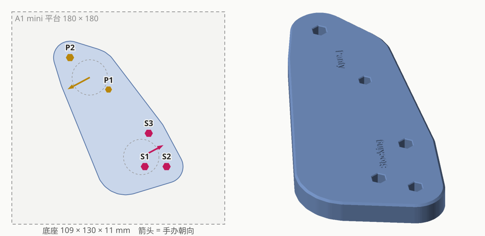
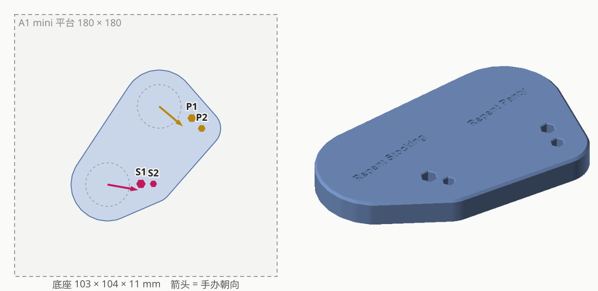

# figure-bases

自制 3D 打印手办底座：把原厂分开的底座合成一块、按自己想要的摆法重新排，省空间。
CadQuery 建模，Bambu Lab A1 mini 打印。

## 底座一览

| | 手办 | 摆法 | 底座（mm） | 打印 |
|---|---|---|---|---|
|  | [**東方仗助 × 岸辺露伴**](pop-up-parade/josuke-higashikata__rohan-kishibe)<br>POP UP PARADE Josuke Higashikata / Rohan Kishibe<br>『ジョジョの奇妙な冒険 ダイヤモンドは砕けない』 | 交叠 | 146 × 97 | 52 分钟 / 44g |
|  | [**2B × A2**](pop-up-parade/2b__a2)<br>POP UP PARADE 2B / A2<br>『NieR:Automata Ver1.1a』 | L 形，带鞋跟凹槽 | 128 × 144 | 54 分钟 / 47g |
|  | [**Panty & Stocking**](pop-up-parade/panty__stocking)<br>POP UP PARADE Panty & Stocking Set<br>『Panty & Stocking with Garterbelt』 | 背靠背 | 110 × 130 | 44 分钟 / 35g |
|  | [**Panty & Stocking Repent Ver.**](pop-up-parade/panty__stocking_repent)<br>POP UP PARADE Panty & Stocking Set: Repent Ver. L Size | 并排 | 103 × 104 | 37 分钟 / 29g |
|  | [**贝雷特 × 贝雷丝**](pop-up-parade/byleth-male__byleth-female)<br>POP UP PARADE Byleth (Male) / Byleth (Female)<br>『Fire Emblem: Three Houses』 | 并排 | 153 × 157 | 1 小时 04 分 / 57g |
|  | [**哲 × 铃**](pop-up-parade/wise__belle)<br>POP UP PARADE SP Wise / Belle<br>『Zenless Zone Zero』 | 并排 | 77 × 103 | 31 分钟 / 24g |
|  | [**露比 × 爱 × 阿库亚 × 有马加奈**](pop-up-parade/ruby__ai__aqua__kana-arima)<br>POP UP PARADE Ruby / Ai / Aqua / Kana Arima<br>『【推しの子】』 | 四人弧形，爱站 5mm 圆台 | 两块燕尾榫拼：127 × 124 + 106 × 85 | 1 小时 27 分 / 71g |

全部已打印，厚度都是 11mm，都刻了手办名字。打印参数：A1 mini · 0.4 喷嘴 · 0.20mm Standard · Bambu PLA Basic。

## 目录结构

```
pop-up-parade/<角色>__<角色>/   一套一个文件夹，名字按商品名
├── README.md                   手办官网链接、效果图、孔位和参数、过程
├── base.py                     生成脚本：实测数据和试出来的参数都在开头
├── base.step                   最终模型（分块的是 base_<块>.step）
├── base_a1mini.3mf             切好片，直接打印（分块的拼在一盘）
└── images/                     preview.svg 效果图，holes.svg 孔位编号
tools/                          各套共用的工具
```

重新生成：`python base.py` 出 STEP，加 `--slice` 再切片成 3mf，加 `--preview` 重画效果图（切片用的 STL 在 `build/`，不进仓库）。

过程中的东西（验证垫块、孔径试样、试摆底座、打印过的旧版本、几套拼一盘的打印盘）只在各自 README 的"过程"表里留一句结论，
文件本身在 tag [`archive/process-2026-10-08`](https://github.com/Borealin/figure-bases/tree/archive/process-2026-10-08) 里。
新的一套在做的时候，过程件也由 base.py 生成到 `build/`；定稿后 base.py 只留最终底座，过程写进 README。

## 流程

1. **测量**：游标卡尺量每根脚钉的直径和露出长度，以及原厂底座上孔与孔的距离（近边距，或者圆周上的最远距离）。
   原厂是六边形孔时，中心距 ≈ 近边距 + (r1 + r2) × 1.05；圆孔直接加两个半径。
   数字卡尺没电时读数会整体偏小，而且彼此还自洽（2B × A2 那次只有真值一半），拿照片比例交叉核对一下。
   原厂底座上如果有放鞋跟的凹槽，要量它的形状和**深度**，深度不对会把鞋跟垫高。
2. **拍照**：空底座正上方俯拍（定孔位的左右 / 镜像方向，也用来推手办朝向），再拍手办正面。
3. **验证垫块 + 孔径试样**：每只脚一个比鞋底还小的垫块，两个手办能贴多近都不会被垫块挡住。
   - 垫块的孔按实测钉径（100%）开；同一波另出 96 / 98 / 100 / 102 / 104% 五档孔径试样，对比着试松紧
   - 每根钉一组圆柱试样；同一套里几根钉粗细接近时，改成一根公差条（一行一根钉 × 五档）更省
   - 两根钉在同一只鞋上、只隔 7～14mm 时，多行公差条会被另一根钉顶住：改用窄的档位条，鞋横过来放；
     粗细接近的钉合用一根条（每根钉都能找到自己的五档），侧面刻对边距 ×100
   - 几套可以一次量完、垫块和试样拼一盘打
4. **试摆**：垫块粘在垫子上摆出想要的效果，拔下手办，量跨手办的孔边距离，用最小二乘解出相对位置。
   - 近边距按六边形外接圆半径换算成中心距，拟合后有比实测近的就整体往外推——**宁远勿近**
   - 每人只有两个孔时距离解不出镜像：给出"正面看从左到右的孔顺序"，再结合原厂底座俯拍推出的朝向就能定
   - 多量几条有冗余，记错的数（比如 104.9 / 114.9）能交叉检查出来
   - 三人以上：几组一起最小二乘（多起点）；每组除了量隔壁，再量一条连到更远一个人的孔，帮着定镜像，
     还分不出来时用原厂底座俯拍推出的朝向挑（各人朝向最一致的那个解）；宁远勿近沿链一组一组往外推
5. **试摆底座**：0.8mm 薄底板 + 每孔一个桩 + 加强筋 + 凸字，省料，确认摆位、朝向和重心。
6. **正式底座**：11mm 实心整板 + 刻字。外轮廓包住所有孔和原厂底座中心周围 15mm（保证重心在底座内），再留 10mm 边。
   没钉的那只脚（踮脚之类）也要落在底座上。整块超过平台（176mm）就切块，燕尾榫拼。
7. **定稿**：base.py 只留最终底座，出 STEP、3mf、效果图；README 写手办链接、参数和一张过程表。

经验参数（A1 mini + Bambu PLA Basic + 0.20mm Standard）：

- 六边形孔对边距 ≈ 钉径 × 1.00 ～ 1.01，同一批钉松紧差别也不小，所以第一波就出五档试样
- 试装后要调粗细时**不要一步调满**：0.1mm 的差别手感就很明显（Panty × Stocking 的 P1 是 5.2 偏松、5.1 偏紧、5.12 刚好），
  觉得松就在试过的孔上 −2%、紧就 +2% 出圆柱试样，试完再定。
  天使版 Panty × Stocking、贝雷特、哲 × 铃三套最后定的孔都在垫块孔的 −2% ～ +2% 之间，折合实测钉径的 99% ～ 103%，大多数就是 100%
- 孔深 = 钉长 + 1.5mm，孔口 0.4mm 倒角；底座 11mm 厚，钉最长 8.5mm 时孔底还剩 1mm
- 鞋跟凹槽每边放大 0.3～0.5mm，深度照原厂
- 脚底的钉是注塑的，不一定平行（会往外撇或往里收）：孔太紧最后一点扣不到底，太松最后一点自己弹出来，两根钉的那只脚孔要取中间
- 燕尾榫（竖着插，PLA）：总间隙 0 太紧，0.1 略松，0.3 松过头 → 取 0.05（两边各 0.025）
- 给某个人垫高做舞台前先看会不会撞到旁边人抬起的手肘之类（【推しの子】那套只能抬 5mm）

## 工具

| 文件 | 用途 |
|---|---|
| `tools/fit_samples.py` | 孔径试样：圆柱试样（帽子形，一档一个）、公差条、窄档位条（粗细接近的钉合用一根）、五档 / ±2% 档位计算 |
| `tools/setkit.py` | 每套 base.py 的收尾：导出 STEP、`--slice` 切片成一盘 |
| `tools/basekit.py` | 两组 / 多组孔的摆放求解（多起点最小二乘、按朝向挑镜像、宁远勿近外推）、朝向 / 左右顺序核对、外轮廓、底座建模（凹槽、舞台、燕尾榫分块）、自动找位置刻字 |
| `tools/base_preview.py` | 底座预览图：平台上的俯视图（孔、原厂底座中心、手办朝向）+ 立体图 |
| `tools/heic2jpg.py` | iPhone HEIC 照片转 JPG（ffmpeg 拼回分块网格） |
| `tools/slice_a1mini.ps1` | 用 Bambu Studio 命令行切片，输出可直接打印的 `.3mf`；`-Stl a.stl,b.stl` 多个模型拼一盘 |
| `tools/flatten_preset.py` | 展开 Bambu 系统预设的继承链（命令行不会自己展开，否则用的是默认参数） |
| `tools/render.py` | 只依赖 numpy 的简易渲染器，给 README 出预览图 |

## 环境

- Python 3.10+，`pip install -r requirements.txt`（CadQuery）
  - Windows：CadQuery 的 OCP DLL 放在太深的路径下会报"文件名或扩展名太长"，要装在短路径里，
    例如 `pip install --target cqlib cadquery`，运行前设 `PYTHONPATH=<仓库>/cqlib`（`cqlib/` 已在 .gitignore 里）
- ffmpeg（转换照片）
- Bambu Studio（切片，默认装在 `C:\Program Files\Bambu Studio`）
