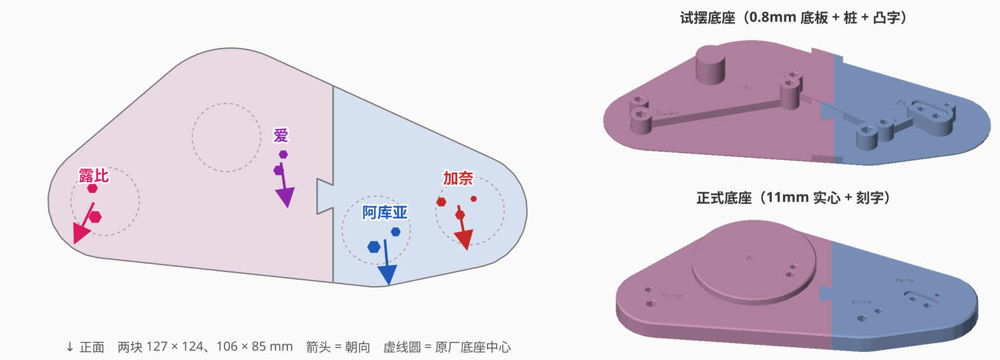

# 【推しの子】 露比 × 爱 × 阿库亚 × 有马加奈 合体底座

| | |
|---|---|
| 手办 | 星野瑠美衣（露比）、星野爱、星野爱久爱海（阿库亚）、有马加奈，商品名待补；确定后挪到对应系列文件夹 |
| 摆法 | 正面看从左到右 露比 → 爱 → 阿库亚 → 加奈；爱居中靠后（可垫高做舞台），视线链：加奈看阿库亚、阿库亚看爱 |
| 状态 | 已打印（`base_*_v1`），效果 OK；`base_*` 是阿库亚两个孔再细 1% 的版本（只有右块变了） |
| 打印 | Bambu A1 mini，0.20mm Standard，PLA Basic；两块拼一盘约 1h27m / 71g |
| 成品 | 整块放不下 A1 mini，在爱和阿库亚中间切成两块：露比 + 爱 127 × 124、阿库亚 + 加奈 106 × 85，燕尾榫拼接（总间隙 0.05），厚 11；爱站在 Ø72、高 5mm 的圆台上 |

## 孔位


每个人都只有一只脚有钉（两根钉在同一只鞋上）；加奈另一只脚抬起的鞋跟下面还有一根金属柱 K3。

| | R1 | R2 | A1 | A2 | Q1 | Q2 | K1 | K2 | K3 |
|---|---|---|---|---|---|---|---|---|---|
| 钉径 | 5.05 | 4.17 | 4.15 | 3.65 | 5.15 | 3.85 | 3.85 | 3.88 | 2.46（金属） |
| 钉长 | 6.8 | 6.8 | 7.2 | 7.2 | 7.0 | 7.0 | 5.0 | 5.0 | 6.6 |

- 组内中心距（钉圆周最远距离 − 两半径）：R1–R2 12.64，A1–A2 7.30，Q1–Q2 11.62，K1–K2 9.97，K1–K3 14.20，K2–K3 9.23
- 加奈的鞋嵌在原厂底座的鞋形凹槽里：深 2mm，鞋长 21.55，鞋头宽 8.3（K2 那头），鞋跟宽 6.2（K1 那头）；凹槽每边放大 0.4
- K3 在 K1→K2 的左手边（俯拍定的），三个孔本身就定了镜像
- 原厂底座：爱 Ø≈98，其余 Ø≈64；底座中心相对孔的位置从 IMG_5188 估（`ORIG_CENTER`）

## 孔径档位条

粗细接近的钉合用一根条，每根钉都能在条上找到自己的 96 / 98 / 100 / 102 / 104%。侧面刻的是对边距 ×100：

| 钉 | 96% | 98% | 100% | 102% | 104% |
|---|---|---|---|---|---|
| A2 | 350 | 358 | 365 | 371 | 378 |
| Q2、K1、K2 | 371 | 378 | 386 | 393 | 401 |
| R2、A1 | 399 | 407 | 416 | 424 | 432 |
| R1 | 485 | 495 | 505 | 515 | 525 |
| Q1 | 495 | 505 | 515 | 525 | 536 |
| K3 | 236 | 241 | 246 | 251 | 256 |

两根钉在同一只鞋上、只隔 7～14mm，多行的公差条会被另一根钉顶住，所以每根条做得很窄：试的时候把鞋横过来放，另一根钉垂在条外面。

## 试装结果（垫块 + 档位条 v1）

垫块基本都合适，孔径按档位条选：

| | R1 | R2 | A1 | A2 | Q1 | Q2 | K1 | K2 | K3 |
|---|---|---|---|---|---|---|---|---|---|
| 底座孔（对边距） | 5.06 | 4.17 | 4.17 | 3.56 | 5.16 → **5.11** | 3.86 → **3.82** | 3.88 | 3.88 | 2.51 |
| ≈ 实测钉径的 | 100% | 100% | 100.5% | 97.5% | 99% | 99% | 101% | 100% | 102% |

- R1–R2 间距再拉大 0.1（12.64 → 12.74）
- 加奈右脚的鞋形凹槽：前左（大脚趾方向）再扩 0.15，后右再扩 0.1
- K3 在右脚的左边，正好是左脚抬起的鞋跟，和俯拍照片定的镜像一致
- 正式底座 v1 打印后：阿库亚的两根钉注塑得不完全平行（会往外撇或往里收），孔偏松时最后一点会自己弹出来，偏紧又扣不到底 → Q1、Q2 再细 1%

## 摆位



量法见 [docs/measure-layout.svg](docs/measure-layout.svg)：垫块 v2 上量 15 条孔边距，按六边形外接圆半径换成中心距（宁远勿近）。

- 四组一起最小二乘（加奈固定，其余三组各 3 个自由度，多起点），拟合残差 < 0.3mm
- K1 差不多在 Q1–Q2 的延长线上，A1–K1 那条分不出爱的镜像：用 IMG_5188 俯拍推出的各人朝向挑，只有一个解四个人朝向大致一致（最多差 36°，露比往左偏得最多），另一个解爱会脸朝后
- 沿 加奈 → 阿库亚 → 爱 → 露比 依次往外推：0.3 / 0.2 / 0.1mm，之后没有一条比实测近
- 结果：爱最靠后；阿库亚比爱靠前 33mm，加奈在阿库亚后面 15mm，露比比爱靠前 17mm

## 试摆

1. v1（两块）：位置没问题；燕尾榫两边各让 0.15（总间隙 0.3）松过头了；爱最多只能抬高 5mm 左右，再高会碰到阿库亚的手肘
2. 左块 v2：爱站在 Ø72、高 5mm 的圆台上（圆台包住有钉的靴子和踮脚那只，踮脚落点按正面照估，试摆底座上立了一根同高的桩看落点）；
   榫眼改成总间隙 0.1（右块还用 v1），另出两个小榫眼块：总间隙 0（刻 0）、0.2（刻 20）
   - 加了圆台后外轮廓往后长了约 11mm，左块 v2 在接缝后端会比 v1 右块长出一截；榫头位置不变
3. 左块 v2 试下来：
   - 燕尾榫：总间隙 0 太紧，0.1 有一点点松 → 正式版取 0.05（两边各 0.025）
   - 爱踮脚那只落点是对的（脚比桩略高一点，是手办本身的问题，不管）；抬高 5mm 刚好不碰阿库亚的手肘；站得稳
4. 正式底座 v1：两块拼起来没问题

## 文件

| 文件 | 说明 |
|---|---|
| `figure_base.py` | 脚本；`--trial` 验证垫块 v1 和档位条，`--pads` 垫块 v2，`--layout` 解摆位、出两块底座 |
| `out/trial_v1_pads.stl` | 验证垫块（孔 = 实测钉径；加奈的带鞋形凹槽） |
| `out/trial_v1_gauges.stl` | 孔径档位条 |
| `out/trial_v1_a1mini.3mf` | 两样拼一盘（已打印） |
| `out/trial_v2_pads.stl` / `_a1mini.3mf` | 垫块 v2：新孔径、R1–R2 拉开 0.1、加奈凹槽扩大（已打印，摆位用） |
| `out/base_{ruby-ai,aqua-kana}.stl` / `.step`、`base_a1mini.3mf` | **正式底座**两块 + 拼一盘（阿库亚孔再细 1%） |
| `out/base_aqua-kana_a1mini.3mf` | 只重打右块（约 33 分钟 / 24g） |
| `out/base_*_v1*` | 实际打印的正式底座 |
| `out/test_base_thin_*_v1.stl`、`test_base_thin_v1_a1mini.3mf` | 试摆 v1（已打印） |
| `out/test_base_thin_ruby-ai_v2.stl`、`dovetail_coupons_v2.stl`、`test_base_thin_ruby-ai_v2_a1mini.3mf` | 左块 v2 + 榫眼小块 |
| `out/dovetail_coupon_v3_005*` | 总间隙 0.05 的榫眼小块（没打，直接打了正式版） |
| `preview.py` | 生成 `docs/base.svg` |

原始照片（IMG_5182、IMG_5188.HEIC）没有放进仓库。

## 重新生成

```bash
python figure_base.py --layout     # 解摆位，出正式底座和试摆底座
python preview.py
pwsh ../../tools/slice_a1mini.ps1 -Stl out/base_ruby-ai.stl,out/base_aqua-kana.stl -Out out/base_a1mini.3mf
```
