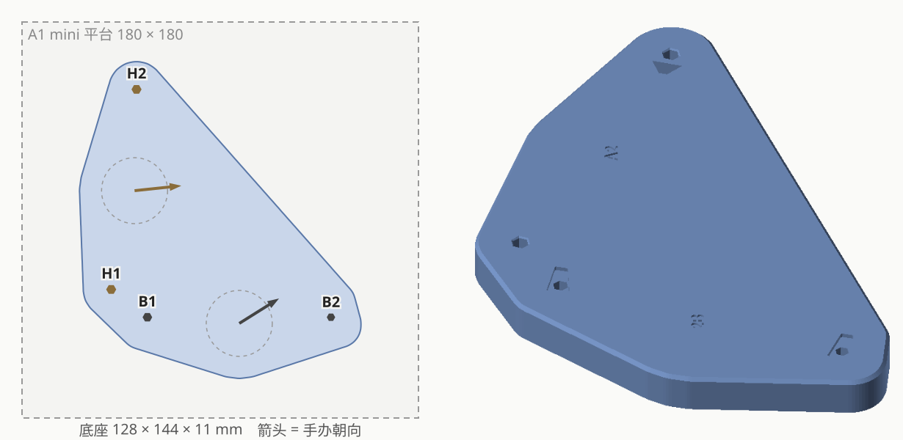

# 2B × A2 合体底座

| | |
|---|---|
| 手办 | [POP UP PARADE 2B (YoRHa No.2 Type B)](https://www.goodsmile.com/en/product/47298)（约 170mm，圆底座） [POP UP PARADE A2 (YoRHa Type A No. 2)](https://www.goodsmile.com/en/product/47300)（约 170mm，六边形底座） |
| 作品 | 『NieR:Automata Ver1.1a』 |
| 摆法 | L 形，A2 的 H1 脚紧挨 2B 的 B1 脚 |
| 底座 | 128 × 144 × 11mm 实心：4 个钉孔、2 个 2B 鞋跟梯形凹槽、1 个 A2 鞋跟三角凹槽，刻 "2B" / "A2" |
| 打印 | A1 mini · 0.20mm Standard · PLA Basic · 约 54 分钟 / 47g |
| 状态 | 已打印（当时没刻字）；现在的文件加了刻字 |

## 文件

| 文件 | |
|---|---|
| `base.py` | 生成脚本，实测数据、凹槽形状和试出来的参数都在开头；`python base.py [--slice] [--preview]` |
| `base.step` | 最终模型 |
| `base_a1mini.3mf` | 切好片，直接打印 |
| `images/` | 效果图、孔位编号 |

## 孔位与参数

- **B = 2B**：B1、B2 各一只脚，钉孔外套着放鞋跟的梯形凹槽（深 1.2）
- **H = A2**：H1、H2 两个六边形孔；**T** = H2 旁边放鞋跟的三角凹槽

| | B1 | B2 | H1 | H2 |
|---|---|---|---|---|
| 钉径 | 3.75 | 3.30 | 3.94 | 3.88 |
| 钉长 | 5.50 | 5.65 | 3.70 | 3.70 |
| 底座孔（对边距） | 3.79 | 3.33 | 3.95 | 3.94 |

- 孔对边距 = (钉径 + 间隙) × 1.01：H1 −0.03、H2 +0.02，其余 0
- 2B 鞋跟凹槽：B1 实测（总长 9.85、宽头 5.7、窄头 3.1，一侧直边一侧斜边），每边放大 0.3，宽头再外推 0.2；
  B2 照片估，两次收窄到 宽头 5.45 / 窄头 2.6，每边放大 0.5；深度照原厂 1.2
- A2 三角凹槽：底边 7.42、两腰 6.6，两腰和尖端放大 0.5，深 4（宁深勿浅）
- 跨手办近边距（垫块上量）：B1–H1 16.95、B1–H2 99.5、B2–H1 96.55、B2–H2 132.35，拟合残差 < 0.3mm；镜像对照实物选的

## 过程

| # | 打印了什么 | 结果 → 改动 |
|---|---|---|
| 1 | 验证垫块 + 两排公差条 | H1 略松、H2 略紧；B1 钉孔要相对凹槽挪 0.2 / 0.3；B2 凹槽略松 |
| 2 | 验证垫块 v2，摆 L 形 | 量 6 条近边距，再对照实物定镜像 |
| 3 | 试摆底座 | B1 凹槽宽头外推 0.2；所有钉孔放大 1% |
| 4 | 正式底座 | 一次成功 |
| — | 加刻字（未重打） | 现在的文件 |

坑：
- **数字卡尺没电时读数会系统性偏小**（这次差不多只有一半），各读数之间还互相吻合，拿照片比例一对才发现
- 鞋跟凹槽的**深度必须照原厂**，否则鞋跟被垫高，人往后仰

过程中的垫块、公差条、试摆底座、镜像对比图和当时打印的版本在 tag [`archive/process-2026-10-08`](https://github.com/Borealin/figure-bases/tree/archive/process-2026-10-08/pop-up-parade/2b__a2) 里。原始照片（IMG_4986 ～ 4994）没有放进仓库。
