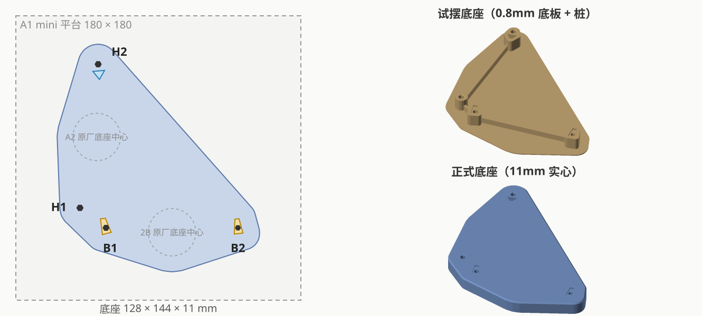
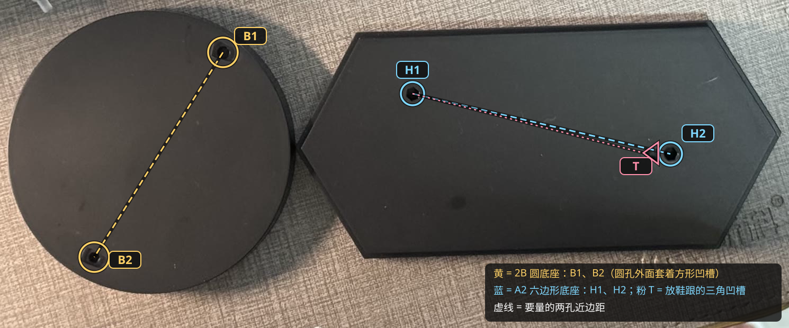

# POP UP PARADE 2B × A2 合体底座

| | |
|---|---|
| 手办 | Good Smile Company **POP UP PARADE 2B（ヨルハ二号B型）**（约 170mm，圆底座）<br>Good Smile Company **POP UP PARADE NieR:Automata Ver1.1a A2（ヨルハA型二号）**（约 170mm，六边形底座） |
| 作品 | 『NieR:Automata Ver1.1a』 |
| 目的 | 2B 的圆底座（Ø≈99mm）和 A2 的六边形底座（≈166 × 80mm）合成一块，两人站成 L 形，A2 的 H1 脚紧挨 2B 的 B1 脚 |
| 成品 | 128 × 144 × 11mm 实心底座：4 个钉孔、2 个 2B 鞋跟梯形凹槽、1 个 A2 鞋跟三角凹槽 |
| 打印 | Bambu A1 mini，0.4 喷嘴，0.20mm Standard @BBL A1M，Bambu PLA Basic，约 53 分钟 / 47g |
| 状态 | 已打印（`base_v1`），效果 OK；`base` 是后来加了刻字 "2B" / "A2" 的版本 |



## 孔位编号



- **B = 2B**：B1、B2 各一只脚（鞋跟上的透明钉）。钉孔外面套着放鞋跟的梯形凹槽，深 1.2mm。B1 的钉更粗，是 IMG_4992 里左边那个槽。
- **H = A2**：H1、H2 各一只脚；**T** 是 H2 旁边放鞋跟的三角凹槽。
- 坐标系：B1 为原点，B2 在 +X，从 B1 看向 B2 左手边为 +Y；H2 在左手边（方案 A，见 [docs/layout-mirror-check.svg](docs/layout-mirror-check.svg)）。

## 实测数据

脚钉（mm）：

| | B1 | B2 | H1 | H2 |
|---|---|---|---|---|
| 直径 | 3.75 | 3.30 | 3.94 | 3.88 |
| 露出长度 | 5.50 | 5.65 | 3.70 | 3.70 |

H1、H2 用的是第一次读数 ×2（见下面"踩过的坑"），B1、B2 是重新量的。

2B 鞋跟凹槽（深 1.2，量法见 [docs/heel-recess-measure.svg](docs/heel-recess-measure.svg)）：

| | 总长 | 宽头 | 窄头 | 孔边→宽头边 | 来源 |
|---|---|---|---|---|---|
| B1 | 9.85 | 5.7 | 3.1 | 1.2 | 实测；形状按俯拍照片：一侧直边、一侧斜边，宽头边斜约 7.7° |
| B2 | 9.3 | 5.6 → 5.45 | 2.9 → 2.6 | 2.0 | 照片估，按试装结果两次收窄 |

A2 三角凹槽：底边（靠 H2）7.42，两腰 6.6，底边离 H2 孔边 2.2；尖端方向 = H2→H1 方向逆时针转 12°。

摆位置用的是垫块上量的近边距（垫块上都是六边形孔，所以都按"中心距 = 近边距 + (r1 + r2) × 1.05"换算）：

| | B1–H1 | B1–H2 | B2–H1 | B2–H2 | B1–B2 | H1–H2 |
|---|---|---|---|---|---|---|
| 近边距 | 16.95 | 99.5 | 96.55 | 132.35 | 79.65 | 87.55 |
| 中心距 | 20.99 | 103.51 | 100.35 | 136.12 | 83.35 | 91.66 |

最小二乘拟合残差 < 0.3mm。最终孔中心（mm）：

| B1 | B2 | H1 | H2 |
|---|---|---|---|
| (0, 0) | (83.35, 0) | (−16.44, 12.62) | (−4.94, 103.55) |

## 最终配合参数（A1 mini + PLA Basic）

| 孔 | 钉径 | 间隙 | ×1.01 后的六边形对边距 |
|---|---|---|---|
| B1 | 3.75 | 0 | 3.788 |
| B2 | 3.30 | 0 | 3.333 |
| H1 | 3.94 | −0.03 | 3.949 |
| H2 | 3.88 | +0.02 | 3.939 |

- B1 凹槽：轮廓每边放大 0.3；钉孔相对凹槽往左 0.2、往窄头方向 0.3；宽头边再往外推 0.2
- B2 凹槽：轮廓每边放大 0.5
- T：两腰和尖端放大 0.5（靠 H2 的底边不动，保住和孔之间的隔墙），深 4mm（宁深勿浅）
- 钉孔深 = 钉长 + 1.5；2B 的钉孔从凹槽底往下开，槽底的孔不倒角（B1 的孔几乎贴着凹槽斜边）

## 过程记录

1. **测量 + 拍照**（IMG_4986 ~ 4988）：两个孔位、钉、A2 的三角凹槽。
2. **验证件 v1**（[docs/trial_v1.svg](docs/trial_v1.svg)）：4 个垫块 + 两排公差条（−0.1 ~ +0.3）。
   - H1 略松、H2 略紧
   - B1 凹槽要让钉孔相对凹槽往左 0.2、往上 0.3
   - B2 凹槽略松
3. **验证件 v2**（[docs/trial_v2.svg](docs/trial_v2.svg)）：B2 再收一点后开始试摆。量了 6 个近边距，外加几个辅助距离：H1 到 T 尖端 79.7，两个凹槽的窄头 / 宽头最近角点 79.9 / 77.3。
4. **镜像确认**：两个手办各只有两个孔，距离解不出镜像，对照实物选了方案 A。
5. **试摆底座 v1**：0.8mm 底板 + 桩 + 加强筋。试装后 B1 凹槽宽头外推 0.2，所有钉孔放大 1%。
6. **正式底座**：11mm 实心，一次成功。

踩过的坑：

- **数字卡尺没电时，读数会系统性偏小**，这次差不多只有真值的一半，而且各个读数之间还互相吻合，很难察觉。拿读数和照片里的底座比例一比才发现：钉只有 2mm 粗，手办却有 17cm 高，对不上。换电池重量 B1、B2 后，确认其余读数 ×2 即可。
- 鞋跟凹槽的**深度必须照原厂**，否则鞋跟会被垫高，人往后仰；三角凹槽宁深勿浅。
- 2B 凹槽的朝向有两套数据：原厂底座照片和垫块角点距离，两者差 1.4mm。垫块是圆角、还会跟着鞋跟晃，所以最后按原厂照片做，试摆底座验证可以用。

## 文件

| 文件 | 说明 |
|---|---|
| `figure_base.py` | CadQuery 脚本，实测数据、配合参数和每次试装的调整都在开头 |
| `preview.py` | 生成 `docs/base.svg`（加 `--trial` 生成垫块预览） |
| `out/base.stl` / `.step` / `_a1mini.3mf` | **正式底座**，带刻字 |
| `out/base_v1*` | 实际打印的正式底座（无刻字） |
| `out/test_base_thin*.stl` / `_a1mini.3mf` | 试摆底座：`_v1` 是实际打印试装的版本，不带后缀的是按最终参数生成的 |
| `out/trial_v1*` / `out/trial_v2*` | 验证件 v1（垫块 + 公差条）、v2（只有垫块），都是当时实际打印的版本 |
| `docs/` | 孔位编号、凹槽测量图、镜像对比、各阶段预览 |

原始照片（IMG_4986 ~ 4994.HEIC）没有放进仓库。

## 重新生成

```bash
python figure_base.py
python preview.py
pwsh ../../tools/slice_a1mini.ps1 -Stl out/base.stl
```

`python figure_base.py --trial` 会按当前参数重新生成验证垫块，覆盖 `out/trial_v2.stl`。
