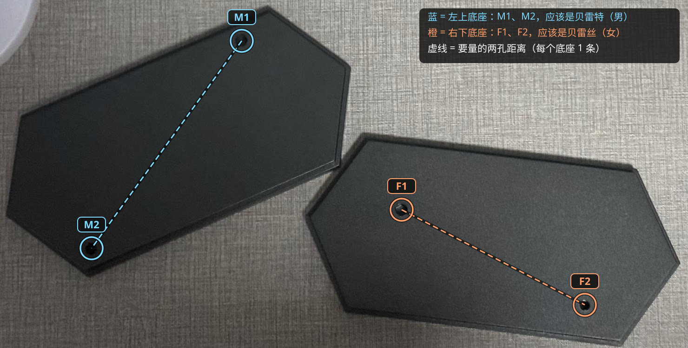

# 贝雷特 × 贝雷丝 合体底座

| | |
|---|---|
| 手办 | [POP UP PARADE Byleth (Male)](https://www.goodsmile.com/en/product/36047)（约 150mm） [POP UP PARADE Byleth (Female)](https://www.goodsmile.com/en/product/36048)（约 150mm） |
| 作品 | 『Fire Emblem: Three Houses』 |
| 摆法 | 并排，正面看从左到右 M2 M1 F1 F2（男在左） |
| 底座 | 153 × 157 × 11mm 实心，4 个六边形孔，刻 "Byleth M" / "Byleth F" |
| 打印 | A1 mini · 0.20mm Standard · PLA Basic · 约 1 小时 04 分 / 57g |
| 状态 | 已打印，效果 OK |

## 文件

| 文件 | |
|---|---|
| `base.py` | 生成脚本，实测数据和试出来的参数都在开头；`python base.py [--slice] [--preview]` |
| `base.step` | 最终模型 |
| `base_a1mini.3mf` | 切好片，直接打印 |
| `images/` | 效果图、孔位编号 |

## 孔位与参数

每只脚一个钉，分在原厂长六边形底座两头（M = 贝雷特，F = 贝雷丝）：

| | M1 | M2 | F1 | F2 |
|---|---|---|---|---|
| 钉径 | 5.05 | 4.55 | 4.8 | 3.65 |
| 钉长 | 6.9 | 6.9 | 7.0 | 7.0 |
| 底座孔（对边距） | 5.02 | 4.55 | 4.82 | 3.65 |
| 相对垫块孔（钉径 × 1.01） | −1.5% | −1% | −0.5% | −1% |

- 组内中心距（原厂底座孔圆周最远距离 − 两半径）：M1–M2 115.2，F1–F2 90.3
- 跨手办近边距（垫块上量）：M1–F1 39.5、M1–F2 117.5、M2–F1 94.15、M2–F2 171.5（超出卡尺量程，权重 0.3）；拟合残差 < 0.2mm，往外推 0.1mm
- 镜像：朝向从原厂底座俯拍推出，两人朝向差 16°，左右顺序对上

## 过程

| # | 打印了什么 | 结果 → 改动 |
|---|---|---|
| 1 | 验证垫块（孔 = 钉径 × 1.01）+ 摆位 | 四个孔都偏松；量 4 条跨手办距离 |
| 2 | 圆柱试样（垫块孔 −2%） | M1 −1.5%、M2 −1%、F1 −0.5%、F2 −1% |
| 3 | 正式底座（跳过了试摆底座） | 效果 OK |

过程中的垫块、试样和试摆底座在 tag [`archive/process-2026-10-08`](https://github.com/Borealin/figure-bases/tree/archive/process-2026-10-08/pop-up-parade/byleth-male__byleth-female) 里。
