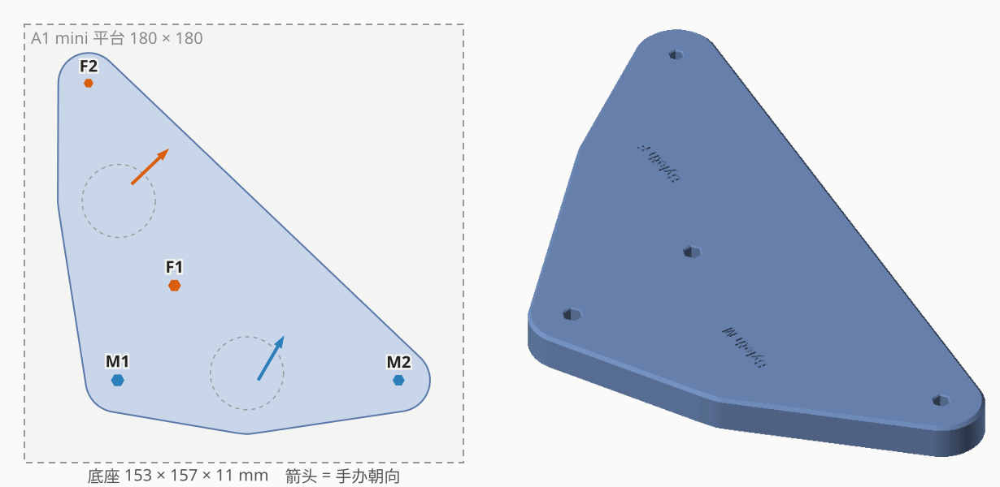

# POP UP PARADE Byleth (Male) × Byleth (Female) 合体底座

| | |
|---|---|
| 手办 | Good Smile Company **POP UP PARADE Byleth (Male)**、**POP UP PARADE Byleth (Female)**（ベレト／ベレス，约 17cm） |
| 作品 | 『Fire Emblem: Three Houses』 |
| 摆法 | 并排，正面看从左到右 M2 M1 F1 F2（男在左） |
| 成品 | 153 × 157 × 11mm 实心底座，刻 "Byleth M" / "Byleth F" |
| 打印 | 单独一盘（`plates/plate_byleth-base`），约 1 小时 03 分 / 57g |
| 状态 | 试摆中（`plates/plate_test_byleth`） |

## 孔位

每只脚一个钉，分在原厂长六边形底座两头：

| | M1 | M2 | F1 | F2 |
|---|---|---|---|---|
| 钉径 | 5.05 | 4.55 | 4.8 | 3.65 |
| 钉长 | 6.9 | 6.9 | 7.0 | 7.0 |
| 正式底座孔（对边距） | 4.80 | 4.30 | 4.55 | 3.49 |

- 组内中心距（原厂底座孔圆周最远距离 − 两半径）：M1–M2 115.2，F1–F2 90.3
- 跨手办近边距（垫块上量）：M1–F1 39.5、M1–F2 117.5、M2–F1 94.15、M2–F2 171.5（超出卡尺量程，权重降到 0.3）

## 过程

1. 验证垫块 v1（孔 = 钉径 × 1.01）：M 两孔都松 → 各小 0.3；F1 松 → 小 0.3，F2 松 → 小 0.2。
2. 近边距按六边形外接圆半径换算（宁远勿近），拟合残差 < 0.2mm，往外推 0.1mm。超量程那条和其余三条也吻合。
3. 镜像：朝向从 IMG_5172 俯拍推出（正面垂直于六边形长边、朝照片下方），两人朝向差 16°，左右顺序对上实测。
4. 加刻字，出试摆底座。

## 文件

| 文件 | 说明 |
|---|---|
| `figure_base.py` | 脚本（底座部分用 `tools/basekit.py`）；`--trial` 按当前孔径重新生成垫块 |
| `out/base*` | 正式底座 |
| `out/test_base_thin*` | 试摆底座（凸字） |
| `out/trial_v1*` | 验证垫块（已打印） |
