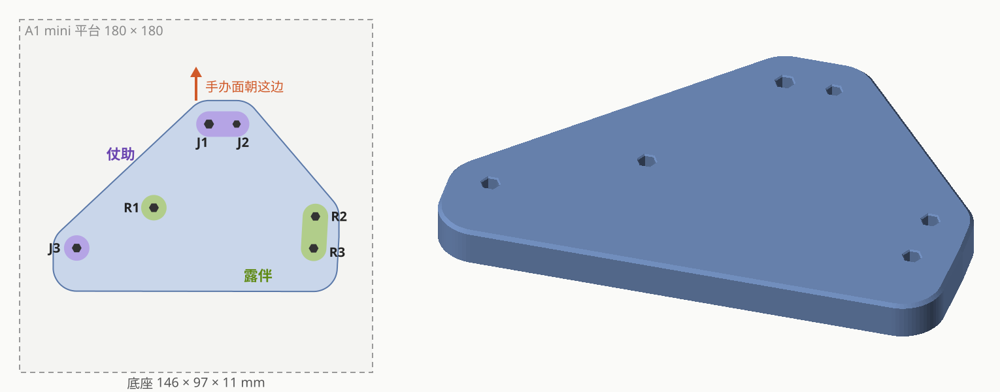

# POP UP PARADE 東方仗助 × 岸辺露伴 合体底座

| | |
|---|---|
| 手办 | Good Smile Company **POP UP PARADE 東方仗助**（2024-12，约 190mm）<br>Good Smile Company **POP UP PARADE 岸辺露伴**（2025-01，约 180mm） |
| 作品 | 『ジョジョの奇妙な冒険 ダイヤモンドは砕けない』 |
| 目的 | 两块原厂六边形底座（约 162 × 74mm）合成一块，两人交叠站位，省空间 |
| 成品 | 146 × 97 × 11mm 实心底座，6 个六边形盲孔 |
| 打印 | Bambu A1 mini，0.4 喷嘴，0.20mm Standard @BBL A1M，Bambu PLA Basic，约 50 分钟 / 44g |
| 状态 | 已打印，效果 OK |



## 孔位编号


- **J = 仗助**：J1 + J2 是前脚（两根钉，J2 明显更细），J3 是后脚（一根钉）
- **R = 露伴**：R1 是前脚（一根钉），R2 + R3 是后脚（两根钉）
- 坐标系：J1 为原点，两个手办都面朝 +Y

## 实测数据

脚钉（游标卡尺，mm）：

| | J1 | J2 | J3 | R1 | R2 | R3 |
|---|---|---|---|---|---|---|
| 直径 | 4.52 | 3.70 | 4.32 | 4.35 | 4.27 | 4.30 |
| 露出长度 | 7.4 | 7.3 | 7.7 | 6.93 | 6.8 | 6.6 |

原厂底座的孔是正六边形。孔距量的是**两个孔的近边距**，换算：中心距 = 近边距 + (r1 + r2) × 1.05。

| 同一手办 | 近边距 | 中心距 | | 跨手办（试摆后） | 近边距 | 中心距 |
|---|---|---|---|---|---|---|
| J1–J2 | 9.8 | 14.12 | | J1–R1 | 43.7 | 48.36 |
| J1–J3 | 87.82 | 92.46 | | J2–R1 | 54.0 | 58.23 |
| J2–J3 | 99.0 | 103.21 | | J1–R2 | 65.4 | 70.01 |
| R1–R2 | 78.0 | 82.53 | | J3–R3 | 116.4 | 120.93 |
| R1–R3 | 79.54 | 84.08 | | | | |
| R2–R3 | 11.8 | 16.30 | | | | |

跨手办的 4 个距离用最小二乘解出露伴相对仗助的位置（平移 + 旋转），残差 < 0.3mm，和俯拍照片估算的位置相差约 1mm。

最终孔中心（mm，已含"露伴往后 3mm"的微调）：

| J1 | J2 | J3 | R1 | R2 | R3 |
|---|---|---|---|---|---|
| (0, 0) | (14.12, 0) | (−67.45, −63.24) | (−28.09, −42.69) | (54.32, −47.14) | (53.40, −63.42) |

## 过程记录

1. **测量 + 拍照**：卡尺量钉和原厂孔距；空底座俯拍用来确定三孔的左右（镜像）方向；正面照用来判断手办朝向。
2. **验证垫块 v1**：每只脚一个小垫块，孔对边距 = 钉径 + 0.2 → **明显偏松**（单脚双钉的间距是对的）。
3. **公差条**：一根钉、孔依次放大 +0.0 ~ +0.4。逐根钉试，每根都是"对边距 = 钉径"最合适 → 间隙改为 0。
4. **验证垫块 v2**：垫块粘在垫子上摆出交叠效果，拔下手办后量 4 个跨手办距离。
5. **试摆底座**：0.8mm 薄底板（首 4 层）+ 每只脚一个 11mm 高的桩 + 前后方向加强筋，省料，用来确认摆位和重心。
6. **实测微调**：露伴整体往后 3mm；底座后沿从后脚后方 32mm 缩到 22mm；改成 11mm 实心整板 → 正式底座。

踩过的坑：

- 原厂底座上孔夹得紧，手办后倾的重心靠钉子撑住。孔一松手办就往后倒，所以试摆用的垫块也要用正确的间隙。
- Bambu Studio 命令行不展开系统预设的继承，早期切片用了很多默认值（时间估算偏长好几倍），后来用 `tools/flatten_preset.py` 解决。

## 文件

| 文件 | 说明 |
|---|---|
| `figure_base.py` | CadQuery 建模脚本，实测数据和所有参数都在文件开头 |
| `preview.py` | 生成 `docs/` 下的预览图 |
| `out/base.stl` / `.step` / `_a1mini.3mf` | **正式底座**（3mf 是切好片的项目，可直接打印） |
| `out/test_pads.stl` / `_a1mini.3mf` | 验证垫块（每只脚一个） |
| `out/tolerance_strip.stl` / `_a1mini.3mf` | 公差条，刻字 0~4 = 孔放大 +0.0~+0.4mm（用 J3 的钉） |
| `out/test_base_thin.stl` | 试摆底座（薄底板 + 桩 + 加强筋） |

原始照片（IMG_4939 ~ IMG_4945.HEIC）没有放进仓库。

## 重新生成

```bash
python figure_base.py
python preview.py
pwsh ../../tools/slice_a1mini.ps1 -Stl out/base.stl
```
