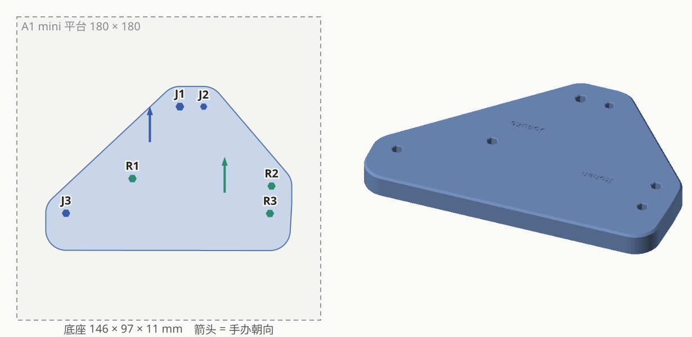
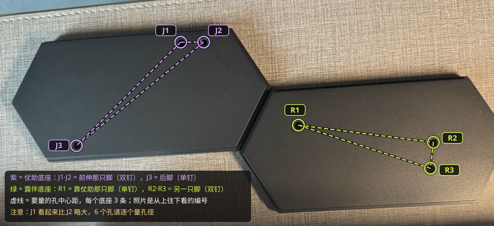

# 東方仗助 × 岸辺露伴 合体底座

| | |
|---|---|
| 手办 | [POP UP PARADE Josuke Higashikata](https://www.goodsmile.com/en/product/35068)（约 190mm） [POP UP PARADE Rohan Kishibe](https://www.goodsmile.com/en/product/35070)（约 180mm） |
| 作品 | 『ジョジョの奇妙な冒険 ダイヤモンドは砕けない』 |
| 摆法 | 交叠站位，两人都面朝前 |
| 底座 | 146 × 97 × 11mm 实心，6 个六边形孔，刻 "Josuke" / "Rohan" |
| 打印 | A1 mini · 0.20mm Standard · PLA Basic · 约 52 分钟 / 44g |
| 状态 | 已打印（当时没刻字）；现在的文件加了刻字 |

## 文件

| 文件 | |
|---|---|
| `base.py` | 生成脚本，实测数据和试出来的参数都在开头；`python base.py [--slice] [--preview]` |
| `base.step` | 最终模型 |
| `base_a1mini.3mf` | 切好片，直接打印 |
| `images/` | 效果图、孔位编号 |

## 孔位与参数

- **J = 仗助**：J1 + J2 前脚（两根钉），J3 后脚；**R = 露伴**：R1 前脚，R2 + R3 后脚（两根钉）
- 原厂孔是六边形，量的是近边距：中心距 = 近边距 + (r1 + r2) × 1.05

| | J1 | J2 | J3 | R1 | R2 | R3 |
|---|---|---|---|---|---|---|
| 钉径 | 4.52 | 3.70 | 4.32 | 4.35 | 4.27 | 4.30 |
| 钉长 | 7.4 | 7.3 | 7.7 | 6.93 | 6.8 | 6.6 |
| 底座孔（对边距） | 4.52 | 3.70 | 4.32 | 4.35 | 4.27 | 4.30 |

- 孔对边距 = 钉径（公差条试出来的），孔深 = 钉长 + 1.5
- 跨手办近边距（垫块上量）：J1–R1 43.7、J2–R1 54.0、J1–R2 65.4、J3–R3 116.4，拟合残差 < 0.3mm
- 露伴整体往后挪 3mm；底座往两人身后多伸 10mm 防后倒

## 过程

| # | 打印了什么 | 结果 → 改动 |
|---|---|---|
| 1 | 验证垫块（孔 = 钉径 + 0.2） | 明显偏松，单脚双钉的间距是对的 |
| 2 | 公差条（+0.0 ～ +0.4） | 每根钉都是"对边距 = 钉径"最合适 → 间隙 0 |
| 3 | 垫块 v2，摆出交叠效果 | 量 4 条跨手办距离，最小二乘解出相对位置 |
| 4 | 试摆底座（0.8mm 底板 + 桩 + 加强筋） | 露伴往后 3mm；底座后沿缩短 10mm |
| 5 | 正式底座 | 效果 OK |
| — | 加刻字（未重打） | 现在的文件 |

坑：原厂底座上孔夹得紧，手办后倾的重心靠钉撑着，孔一松就往后倒，所以试摆用的垫块也要用对的松紧。

过程中的垫块、公差条、试摆底座和当时打印的版本在 tag [`archive/process-2026-10-08`](https://github.com/Borealin/figure-bases/tree/archive/process-2026-10-08/pop-up-parade/josuke-higashikata__rohan-kishibe) 里。原始照片（IMG_4939 ～ 4945）没有放进仓库。
