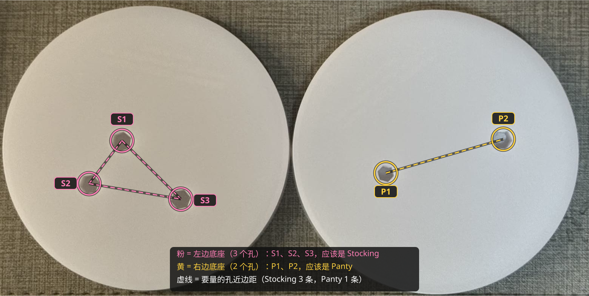

# Panty & Stocking 合体底座（背靠背）

| | |
|---|---|
| 手办 | [POP UP PARADE Panty & Stocking Set](https://www.goodsmile.com/en/product/1140101)（Panty 约 150mm，Stocking 约 140mm） |
| 作品 | 『Panty & Stocking with Garterbelt』 |
| 摆法 | 背靠背 |
| 底座 | 110 × 130 × 11mm 实心，5 个六边形孔，刻 "Stocking" / "Panty"（各朝自己的正面） |
| 打印 | A1 mini · 0.20mm Standard · PLA Basic · 约 44 分钟 / 35g |
| 状态 | 已打印（当时没刻字）；现在的文件加了刻字 |

## 文件

| 文件 | |
|---|---|
| `base.py` | 生成脚本，实测数据和试出来的参数都在开头；`python base.py [--slice] [--preview]` |
| `base.step` | 最终模型 |
| `base_a1mini.3mf` | 切好片，直接打印 |
| `images/` | 效果图、孔位编号 |

## 孔位与参数

- **S = Stocking**：S1 + S2 同一只脚，S3 另一只脚；**P = Panty**：P1、P2 各一只脚
- Stocking 有三个孔，摆位没有镜像歧义

| | S1 | S2 | S3 | P1 | P2 |
|---|---|---|---|---|---|
| 钉径 | 6.0 | 6.0 | 6.0 | 5.2 | 6.0 |
| 钉长 | 7.4 | 7.4 | 7.4 | 8.1 | 8.1 |
| 底座孔（对边距） | 6.06 | 6.06 | 6.06 | **5.12** | 6.06 |

- 孔对边距 = 钉径 × 1.01，P1 单独试出来是 5.12
- 原厂孔距（近边距）：S1–S2 12.1、S1–S3 22.1、S2–S3 25.7、P1–P2 36.5（中心距 = 近边距 + (r1 + r2) × 1.05）
- 跨手办近边距（垫块上量）：P1–S1 64.3、P1–S2 73.7、P1–S3 42.4、P2–S1 103.6、P2–S2 114.9、P2–S3 83.6，拟合残差 < 0.3mm
- 摆位后的微调：Panty 往"后"挪 1mm、再拉开 2mm；Stocking 头发重，她身后的底座多伸 15mm

## 过程

| # | 打印了什么 | 结果 → 改动 |
|---|---|---|
| 1 | 验证垫块（孔 = 钉径 × 1.01） | P1 略松 |
| 2 | P1 单独补打两次 | 5.20 仍松、5.10 偏紧 → 定 5.12 |
| 3 | 垫块摆背靠背 | 量 6 条距离；P2–S2 记成 104.9，用 Panty 两孔固定间距交叉检查发现差 10mm，复量是 114.9 |
| 4 | 试摆底座 | Panty 往后 1mm；Stocking 身后多伸 15mm 防后倒 |
| 5 | 正式底座 v1 | 两人贴得有点近 → Panty 再拉开 2mm |
| 6 | 正式底座 v2 | 效果 OK |
| — | 加刻字（未重打） | 现在的文件 |

过程中的垫块、P1 补打件、试摆底座和当时打印的版本在 tag [`archive/process-2026-10-08`](https://github.com/Borealin/figure-bases/tree/archive/process-2026-10-08/pop-up-parade/panty__stocking) 里。
