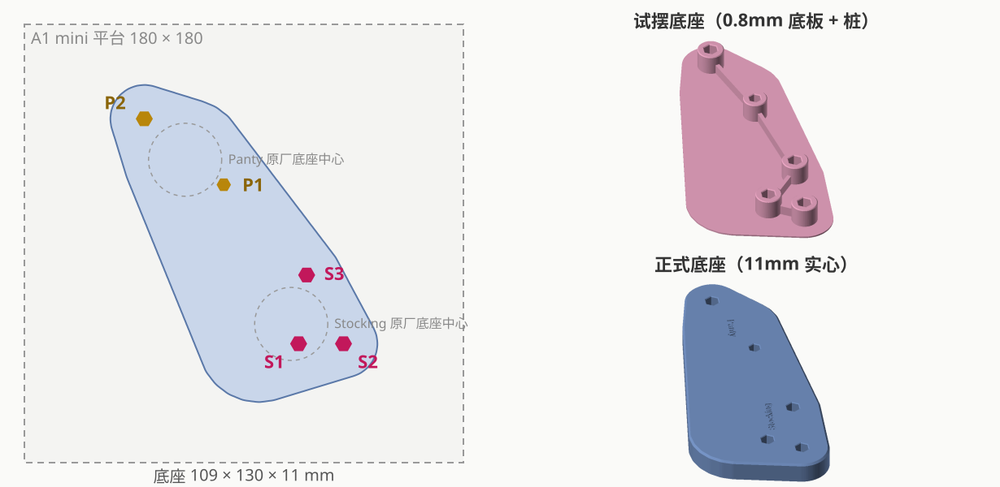

# POP UP PARADE Panty & Stocking Set 合体底座（背靠背）

| | |
|---|---|
| 手办 | Good Smile Company **POP UP PARADE Panty & Stocking Set**（Panty 约 150mm，Stocking 约 140mm） |
| 作品 | 『Panty & Stocking with Garterbelt』 |
| 摆法 | 背靠背 |
| 成品 | 110 × 130 × 11mm 实心底座，5 个六边形孔，刻 "Stocking" / "Panty"（背靠背，各朝自己的正面） |
| 打印 | Bambu A1 mini，0.20mm Standard，PLA Basic，约 44 分钟 / 35g |
| 状态 | 已打印（`base_v2`，无刻字）；`base` 是加了刻字的版本 |

## 孔位

- **S = Stocking**（原厂左边底座）：S1 + S2 同一只脚，S3 另一只脚，三个钉都是 6.0mm，长 7.4
- **P = Panty**（原厂右边底座）：P1 5.2、P2 6.0，长 8.1
- 坐标：S1 原点、S2 在 +X、S3 在左侧（Stocking 有三个孔，没有镜像歧义）

| 原厂孔距（近边距） | S1–S2 | S1–S3 | S2–S3 | P1–P2 |
|---|---|---|---|---|
| 实测 | 12.1 | 22.1 | 25.7 | 36.5 |
| 中心距（×1.05 换算） | 18.4 | 28.4 | 32.0 | 42.4 |

跨手办（垫块上量的近边距）：P1–S1 64.3、P1–S2 73.7、P1–S3 42.4、P2–S1 103.6、P2–S2 **114.9**、P2–S3 83.6，拟合残差 < 0.3mm。

## 过程

1. 验证垫块 v1：孔 = 钉径 × 1.01，P1 略松。P1 单独补打两次（5.20 → 5.10），最后定为 **5.12**。
2. 试摆时 P2–S2 记成了 104.9：用 Panty 两孔间距固定这一条交叉检查，发现差 10mm，复量确认是 114.9。
3. 试摆底座 v1 → Panty 整体往"后"挪 1mm（以 Stocking 为准：S2、S3 在前，S1 在后）。
4. Stocking 头发重、容易往后倒 → 底座在她身后多伸 15mm（`STOCKING_BACK`）。
5. 正式底座 v1 两人贴得有点近 → Panty 沿两组孔中心连线再拉开 2mm（`PANTY_APART`）→ 正式底座 v2，已打印。
6. 加刻字 → 当前的 `base`。

## 文件

| 文件 | 说明 |
|---|---|
| `figure_base.py` | 脚本；`--pad P1` 单独补打一个垫块，`--trial` 重新生成垫块 |
| `out/base*` | 正式底座：`base` 带刻字，`base_v2` 是已打印的版本，`base_v1` 是拉开 2mm 之前的 |
| `out/test_base_thin*` | 试摆底座（`_v1` 是实际打印的） |
| `out/trial_v1*`、`out/pad_P1_v2/v3*` | 验证垫块和 P1 补打件 |
