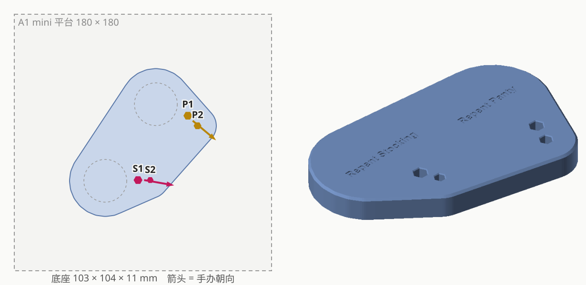

# POP UP PARADE Panty & Stocking Set: Repent Ver. L Size 合体底座

| | |
|---|---|
| 手办 | Good Smile Company **POP UP PARADE Panty & Stocking Set: Repent Ver. L Size**（天使造型，单脚站立） |
| 作品 | 『Panty & Stocking with Garterbelt』 |
| 摆法 | 并排，正面看从左到右 S1 S2 P2 P1（Stocking 在左） |
| 成品 | 103 × 104 × 11mm 实心底座，刻 "Repent Stocking" / "Repent Panty" |
| 打印 | 和哲 × 铃的底座拼一盘（`plates/plate_repent-base+wise-belle-base`） |
| 状态 | 试摆中（`plates/plate_test_repent+wise-belle`） |

## 孔位

每人只有一只脚落地，一大一小两根钉：

| | S1 | S2 | P1 | P2 |
|---|---|---|---|---|
| 钉径 | 5.6 | 4.3 | 5.05 | 4.4 |
| 钉长 | 7.0 | 7.0 | 7.3 | 7.3 |
| 正式底座孔（对边距） | 5.36 | 4.04 | 5.40 | 4.74 |

- 组内中心距（钉圆周最远距离 − 两半径）：S1–S2 8.55，P1–P2 9.78
- 跨手办近边距（垫块上量）：S1–P1 50.5、S1–P2 50.6、S2–P1 46.8、S2–P2 45.0

## 过程

1. 验证垫块 v1（孔 = 钉径 × 1.01）：Stocking 两孔都松 → 各小 0.3；Panty 两孔都紧 → 各大 0.3。
2. 近边距按六边形外接圆半径换算中心距（宁远勿近），拟合残差 < 0.2mm，再把两人往外推 0.2mm 保证没有一对比实测近。
3. 镜像：两人朝向从 IMG_5170 俯拍推出（照片下方是正面），只有一种摆法让两人朝向一致、左右顺序对上实测。
4. 加刻字，出试摆底座。

## 文件

| 文件 | 说明 |
|---|---|
| `figure_base.py` | 脚本（底座部分用 `tools/basekit.py`）；`--trial` 按当前孔径重新生成垫块 |
| `out/base*` | 正式底座 |
| `out/test_base_thin*` | 试摆底座（凸字） |
| `out/trial_v1*` | 验证垫块（已打印） |
