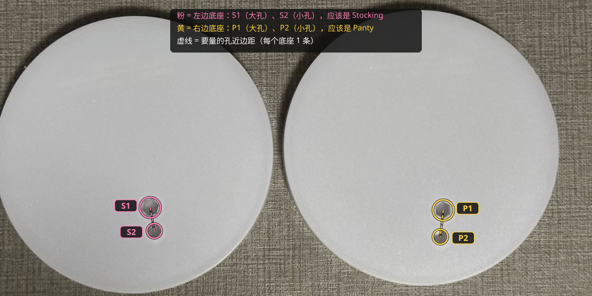

# Panty & Stocking Repent Ver. 合体底座

| | |
|---|---|
| 手办 | [POP UP PARADE Panty & Stocking Set: Repent Ver. L Size](https://www.goodsmile.com/en/product/44804)（约 210mm，天使造型，单脚站立） |
| 作品 | 『Panty & Stocking with Garterbelt』 |
| 摆法 | 并排，正面看从左到右 S1 S2 P2 P1（Stocking 在左） |
| 底座 | 103 × 104 × 11mm 实心，4 个六边形孔，刻 "Repent Stocking" / "Repent Panty" |
| 打印 | A1 mini · 0.20mm Standard · PLA Basic · 约 37 分钟 / 29g |
| 状态 | 已打印，效果 OK |

## 文件

| 文件 | |
|---|---|
| `base.py` | 生成脚本，实测数据和试出来的参数都在开头；`python base.py [--slice] [--preview]` |
| `base.step` | 最终模型 |
| `base_a1mini.3mf` | 切好片，直接打印 |
| `images/` | 效果图、孔位编号 |

## 孔位与参数

每人只有一只脚落地，一大一小两根钉（S = Stocking，P = Panty）：

| | S1 | S2 | P1 | P2 |
|---|---|---|---|---|
| 钉径 | 5.6 | 4.3 | 5.05 | 4.4 |
| 钉长 | 7.0 | 7.0 | 7.3 | 7.3 |
| 底座孔（对边距） | 5.60 | 4.26 | 5.15 | 4.53 |
| 相对垫块孔（钉径 × 1.01） | −1% | −2% | +1% | +2% |

- 组内中心距（钉圆周最远距离 − 两半径）：S1–S2 8.55，P1–P2 9.78
- 跨手办近边距（垫块上量）：S1–P1 50.5、S1–P2 50.6、S2–P1 46.8、S2–P2 45.0；按六边形外接圆半径换算（宁远勿近），拟合残差 < 0.2mm，再往外推 0.2mm
- 镜像：两人朝向从原厂底座俯拍推出，只有一种摆法朝向一致、左右顺序对上

## 过程

| # | 打印了什么 | 结果 → 改动 |
|---|---|---|
| 1 | 验证垫块（孔 = 钉径 × 1.01）+ 摆位 | Stocking 两孔偏松、Panty 两孔偏紧；量 4 条跨手办距离 |
| 2 | 圆柱试样（垫块孔 ±2%） | S1 −1%、S2 −2%、P1 +1%、P2 +2% |
| 3 | 正式底座（跳过了试摆底座） | 效果 OK |

一开始按"各调 0.3mm"一步调满太激进，改成先出 ±2% 的圆柱试样再定（见根目录 README 的经验参数）。

过程中的垫块、试样和试摆底座在 tag [`archive/process-2026-10-08`](https://github.com/Borealin/figure-bases/tree/archive/process-2026-10-08/pop-up-parade/panty__stocking_repent) 里。
