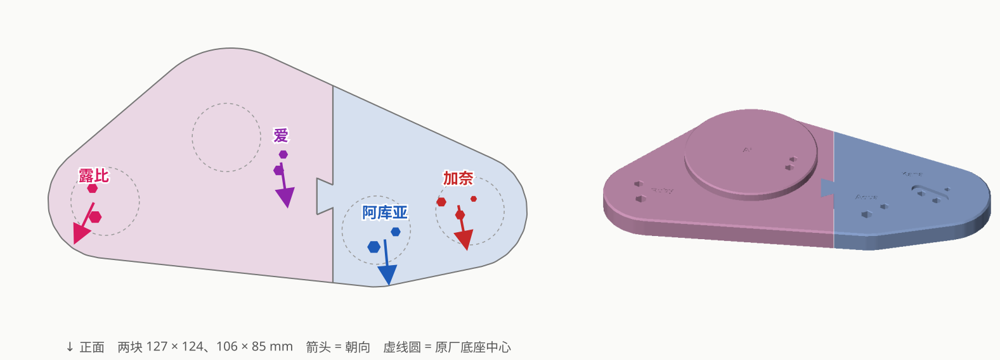
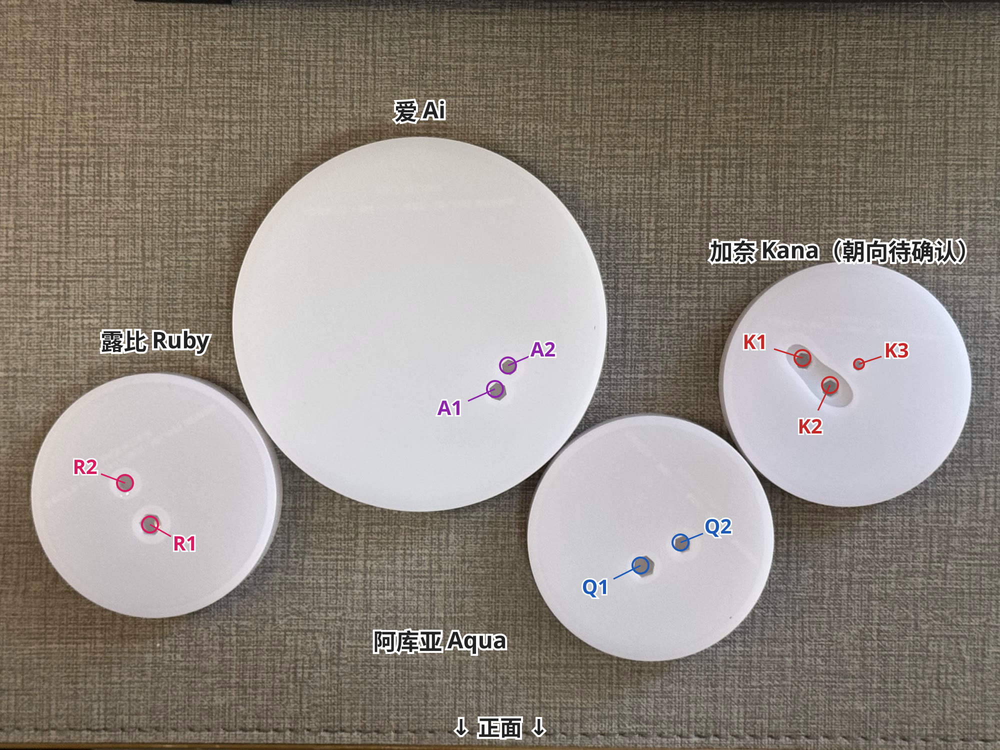

# 露比 × 爱 × 阿库亚 × 有马加奈 合体底座

| | |
|---|---|
| 手办 | [POP UP PARADE Ruby](https://www.goodsmile.com/en/product/55567)（约 170mm） [POP UP PARADE Ai](https://goodsmileshop.com/en/CATEGORY-ROOT/POP-UP-PARADE/POP-UP-PARADE-Ai/p/GSC_WD_05746)（约 170mm） [POP UP PARADE Aqua](https://www.goodsmile.com/en/product/55566)（约 180mm） [POP UP PARADE Kana Arima](https://www.goodsmile.com/en/product/55568)（约 170mm） |
| 作品 | 『【推しの子】』 |
| 摆法 | 正面看从左到右 露比 → 爱 → 阿库亚 → 加奈；爱居中靠后站在 5mm 的圆台上，其余三人在前面排成弧形。视线链：加奈看阿库亚、阿库亚看爱 |
| 底座 | 整块约 210 × 84 放不下 A1 mini，切成两块燕尾榫拼：露比 + 爱 127 × 124、阿库亚 + 加奈 106 × 85，厚 11（圆台处 16）；加奈的鞋形凹槽，刻四个人的名字 |
| 打印 | A1 mini · 0.20mm Standard · PLA Basic · 两块拼一盘约 1 小时 27 分 / 71g |
| 状态 | 已打印；现在的文件阿库亚两个孔再细 1%（只有右块变了） |

## 文件

| 文件 | |
|---|---|
| `base.py` | 生成脚本，实测数据、试出来的参数、四人摆位求解都在开头；`python base.py [--slice] [--preview]` |
| `base_ruby-ai.step`、`base_aqua-kana.step` | 最终模型（两块） |
| `base_a1mini.3mf` | 两块拼一盘，切好片直接打印 |
| `images/` | 效果图、孔位编号 |

## 孔位与参数

每人只有一只脚有钉，两根钉在同一只鞋上。R = 露比，A = 爱（另一只踮脚没钉），Q = 阿库亚，K = 加奈（K1、K2 在右脚，K3 是抬起的左脚鞋跟下的金属柱）。

| | R1 | R2 | A1 | A2 | Q1 | Q2 | K1 | K2 | K3 |
|---|---|---|---|---|---|---|---|---|---|
| 钉径 | 5.05 | 4.17 | 4.15 | 3.65 | 5.15 | 3.85 | 3.85 | 3.88 | 2.46 |
| 钉长 | 6.8 | 6.8 | 7.2 | 7.2 | 7.0 | 7.0 | 5.0 | 5.0 | 6.6 |
| 底座孔（对边距） | 5.06 | 4.17 | 4.17 | 3.56 | 5.11 | 3.82 | 3.88 | 3.88 | 2.51 |

- 组内中心距（钉圆周最远距离 − 两半径）：R1–R2 12.74（试装后拉开 0.1）、A1–A2 7.30、Q1–Q2 11.62、K1–K2 9.97、K1–K3 14.20、K2–K3 9.23
- 加奈的鞋形凹槽：鞋长 21.55、鞋头宽 8.3、鞋跟宽 6.2，深 2；每边放大 0.4，鞋头往前左（大脚趾）再扩 0.15、鞋跟往后右再扩 0.1
- 摆位：垫块上量 15 条孔边距（每组除了量隔壁，再连一条到更远一个人的孔），四组一起最小二乘，残差 < 0.3mm；
  K1 刚好差不多在 Q1–Q2 延长线上，那条判断左右的距离没起作用，最后用原厂底座俯拍推出的朝向挑出唯一四人都朝前的解；
  宁远勿近沿 加奈 → 阿库亚 → 爱 → 露比 推了 0.3 / 0.2 / 0.1mm
- 爱的圆台 Ø72、高 5（再高话筒和头发会碰到阿库亚抬起的手肘），包住有钉的靴子和踮脚那只
- 燕尾榫总间隙 0.05（两边各 0.025）

## 过程

| # | 打印了什么 | 结果 → 改动 |
|---|---|---|
| 1 | 验证垫块（孔 = 实测钉径）+ 4 根孔径档位条（粗细接近的钉合用一根，每根钉都有 96 ～ 104% 五档） | 按档位条定孔径；R1–R2 拉开 0.1；加奈凹槽局部扩大 |
| 2 | 垫块 v2，摆位 | 量 15 条距离 |
| 3 | 试摆底座（两块，燕尾榫总间隙 0.3） | 位置没问题；燕尾榫松过头；爱只能抬高 5mm |
| 4 | 左块试摆 v2（爱抬高 5mm，榫眼总间隙 0.1）+ 两个榫眼小块（0 / 0.2） | 0 太紧、0.1 略松 → 取 0.05；踮脚落点对、站得稳 |
| 5 | 正式底座 | 效果 OK；阿库亚的钉注塑得不平行，孔偏松时最后一点会弹出来 |
| — | 阿库亚两个孔再细 1% | 现在的文件 |

过程中的垫块、档位条、试摆底座、榫眼小块、量法图和当时打印的版本在 tag [`archive/process-2026-10-08`](https://github.com/Borealin/figure-bases/tree/archive/process-2026-10-08/_wip/oshi-no-ko) 里。原始照片（IMG_5182、IMG_5188）没有放进仓库。
