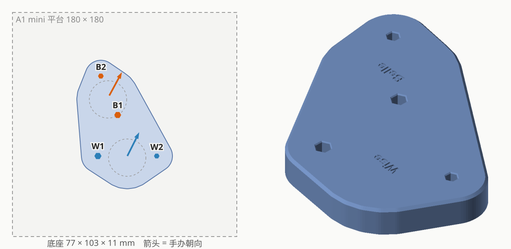

# POP UP PARADE SP Wise × Belle 合体底座

| | |
|---|---|
| 手办 | Good Smile Company **POP UP PARADE SP Wise**、**POP UP PARADE SP Belle**（哲／铃，约 20cm） |
| 作品 | 『Zenless Zone Zero』 |
| 摆法 | 并排，正面看从左到右 W2 W1 B1 B2（哲在左） |
| 成品 | 77 × 103 × 11mm 实心底座，刻 "Wise" / "Belle" |
| 打印 | 和天使版 Panty × Stocking 的底座拼一盘（`plates/plate_repent-base+wise-belle-base`） |
| 状态 | 已打印（`base_v1`），B1 等其余孔都合适，只有 W2 偏紧；`base` 是 W2 放大到 3.97 的版本 |

## 孔位

每只脚一个钉，原厂圆底座：

| | W1 | W2 | B1 | B2 |
|---|---|---|---|---|
| 钉径 | 4.9 | 3.95 | 4.92 | 3.93 |
| 钉长 | 8.5 | 8.5 | 7.6 | 7.6 |
| 试样（松 −2%） | — | 3.91 | 4.87 | — |
| **底座孔（定稿）** | 4.95 | 3.97 | 4.92 | 3.97 |
| 相对垫块孔 | 0 | −0.5% | −1% | 0 |

- 组内中心距（原厂底座孔圆周最远距离 − 两半径）：W1–W2 47.2，B1–B2 34.1
- 跨手办近边距（垫块上量）：W1–B1 30.6、W1–B2 59.0、W2–B1 39.9、W2–B2 73.7
- 哲的钉 8.5mm 是目前最长的，11mm 底座孔底刚好剩 1mm

## 过程

1. 验证垫块 v1（孔 = 钉径 × 1.01）：W2、B1 略松 → 各小 0.15；W1、B2 刚好。
2. 近边距按六边形外接圆半径换算（宁远勿近），拟合残差 < 0.2mm，往外推 0.2mm。
3. 镜像：朝向从 IMG_5174 俯拍推出（照片下方是正面），两人朝向只差 2°，左右顺序对上实测。
4. 加刻字，出试摆底座。
5. 回头看第 1 步按毫米一次调满太激进：改成在垫块孔上 松 −2% / 紧 +2% 出圆柱试样（`python figure_base.py --samples`），试完再定孔径，重出试摆 / 正式底座。
6. 圆柱试样试装后定孔径（相对垫块孔）：W2 −1%、B1 −1%，跳过试摆直接打正式底座（`base_v1`）。
7. `base_v1` 上 W2（3.95）还是偏紧，垫块的 3.99 又偏松 → 取中间 −0.5%（3.97），出 `base`。

## 文件

| 文件 | 说明 |
|---|---|
| `figure_base.py` | 脚本（底座部分用 `tools/basekit.py`）；`--trial` 按当前孔径重新生成垫块 |
| `out/base.*` / `base_a1mini.3mf` | 正式底座（W2 3.97） |
| `out/base_v1*` | 实际打印的正式底座（W2 3.95，偏紧） |
| `out/test_base_thin*` | 试摆底座（凸字） |
| `out/trial_v1*` | 验证垫块（已打印） |
| `out/fit_samples_v1.stl` | 圆柱试样：上刻钉名、下刻档位（-2 / +2 = 垫块孔 −2% / +2%） |
