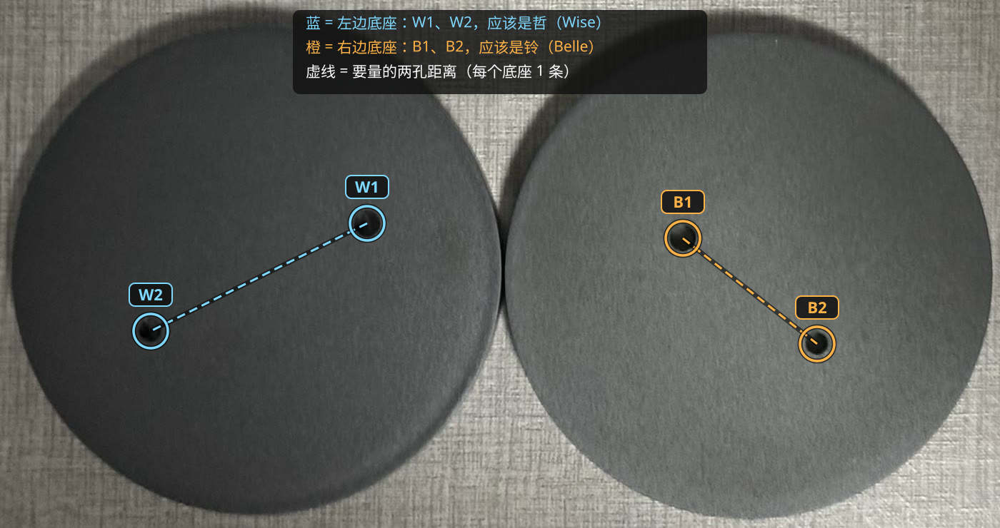

# 哲 × 铃 合体底座

| | |
|---|---|
| 手办 | [POP UP PARADE SP Wise](https://www.goodsmile.com/en/product/61747)（约 201mm） [POP UP PARADE SP Belle](https://www.goodsmile.com/en/product/61059)（约 177mm） |
| 作品 | 『Zenless Zone Zero』 |
| 摆法 | 并排，正面看从左到右 W2 W1 B1 B2（哲在左） |
| 底座 | 77 × 103 × 11mm 实心，4 个六边形孔，刻 "Wise" / "Belle" |
| 打印 | A1 mini · 0.20mm Standard · PLA Basic · 约 31 分钟 / 24g |
| 状态 | 已打印（W2 偏紧）；现在的文件 W2 放大到 3.97 |

## 文件

| 文件 | |
|---|---|
| `base.py` | 生成脚本，实测数据和试出来的参数都在开头；`python base.py [--slice] [--preview]` |
| `base.step` | 最终模型 |
| `base_a1mini.3mf` | 切好片，直接打印 |
| `images/` | 效果图、孔位编号 |

## 孔位与参数

每只脚一个钉，原厂圆底座（W = 哲，B = 铃）：

| | W1 | W2 | B1 | B2 |
|---|---|---|---|---|
| 钉径 | 4.9 | 3.95 | 4.92 | 3.93 |
| 钉长 | 8.5 | 8.5 | 7.6 | 7.6 |
| 底座孔（对边距） | 4.95 | 3.97 | 4.92 | 3.97 |
| 相对垫块孔（钉径 × 1.01） | 0 | −0.5% | −1% | 0 |

- 组内中心距（原厂底座孔圆周最远距离 − 两半径）：W1–W2 47.2，B1–B2 34.1
- 跨手办近边距（垫块上量）：W1–B1 30.6、W1–B2 59.0、W2–B1 39.9、W2–B2 73.7；拟合残差 < 0.2mm，往外推 0.2mm
- 哲的钉 8.5mm 是目前最长的，11mm 底座孔底刚好剩 1mm

## 过程

| # | 打印了什么 | 结果 → 改动 |
|---|---|---|
| 1 | 验证垫块（孔 = 钉径 × 1.01）+ 摆位 | W2、B1 略松，W1、B2 刚好；量 4 条跨手办距离 |
| 2 | 圆柱试样（垫块孔 −2%） | 定 W2 −1%、B1 −1% |
| 3 | 正式底座 v1（跳过了试摆底座） | B1 合适，W2（3.95）还是偏紧 |
| — | W2 取垫块 3.99 和 3.95 的中间 → 3.97 | 现在的文件 |

过程中的垫块、试样、试摆底座和当时打印的版本在 tag [`archive/process-2026-10-08`](https://github.com/Borealin/figure-bases/tree/archive/process-2026-10-08/pop-up-parade/wise__belle) 里。
